  

  Full-stack developer. I build web services end to end: APIs in Go, Node.js and PHP, 
  interfaces in React and TypeScript, and the infrastructure they run on.

  
  
  
  
  
  
  
  
  
  
  

  Fullstack-разработчик. Делаю веб-сервисы целиком: API на Go, Node.js и PHP, 
  интерфейсы на React и TypeScript и инфраструктуру, на которой они работают.

